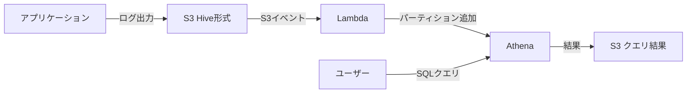

# AWS Athena 導入 - ログ解析基盤の構築 - 詳細なやつ

## 結論・推奨事項

### 導入方針

**推奨:** AWS Athenaをログ解析基盤として段階的に導入

**理由:**
1. **サーバーレス**: インフラ管理不要、即座に開始可能
2. **既存S3ログ活用**: データ移行不要、S3に直接クエリ
3. **コスト効率**: 使った分だけの従量課金（$5/TB）、適切な運用で90%削減可能
4. **スケーラビリティ**: ログ量増加に自動対応

**段階的導入プラン:**
1. **Phase 1**: 小規模ログでPoC（1-2週間）
2. **Phase 2**: Parquet変換とコスト検証（1週間）
3. **Phase 3**: 本格導入とチーム研修（2週間）

### 重要な意思決定ポイント

#### 1. データ形式の選択
- **CSV（現状維持）**: 導入は簡単だがコスト高
- **Parquet変換（推奨）**: 初期投資必要だがコスト90%削減

→ **推奨**: 段階的にParquet移行

#### 2. パーティション戦略
- **日次パーティション（推奨）**: `year/month/day`
- **時間粒度**: ログ量に応じて検討

#### 3. 運用の自動化レベル
- **最低限**: 手動パーティション追加
- **推奨**: Lambda自動化
- **高度**: Glue Crawler + Partition Projection

### チームへの影響・必要な変更

| 対象 | 必要な作業 | 工数目安 |
|------|-----------|---------|
| アプリケーション開発 | Hive形式でログ配置するよう変更 | 1-2日 |
| インフラ | パーティション追加Lambda実装 | 2-3日 |
| 全員 | クエリベストプラクティス習得 | 1日（研修） |

**承認要否:** チームリーダー承認推奨（コスト・運用影響あり）

---

## 背景・目的

### 導入の背景

**現状の課題:**
- ログがS3に蓄積されているが、検索・解析が困難
- 特定期間のログ抽出に時間がかかる
- エラー解析やトレンド分析ができない

**Athena導入で解決:**
- SQLで柔軟なログ検索
- 時間範囲指定で高速抽出
- 集計・分析クエリが可能

### 調査のスコープ

**調査対象:**
- Athenaの基本仕様と料金体系
- カスタムログ形式（`XXX TIMESTAMP <JSON>`）への対応方法
- Hive形式でのログ配置とパーティション運用
- コスト最適化手法

**除外事項（今回は対象外）:**
- リアルタイムログ解析（Athenaはバッチ分析向け）
- ログの長期アーカイブ戦略
- 他の分析ツール（Elasticsearch等）との比較

---

## Athenaの基礎知識

### 料金体系

**基本料金:** $5/TB（スキャンされたデータ量）

**無料対象:**
- テーブル作成・削除などのDDL操作
- パーティション管理
- 失敗したクエリ

**追加コスト:**
- S3ストレージ料金（標準S3料金）
- Glue Data Catalog（100万オブジェクト超で$1/月）
- クエリ結果保存（S3料金）

**コスト例:**
```
1TB CSVログを毎日全スキャン（30日）
= 1TB × $5 × 30 = $150/月

↓ Parquet変換 + 必要な列のみ選択（90%削減）

0.1TB × $5 × 30 = $15/月
```

### 主な制限

- **同時実行クエリ**: 100-200件（リージョン依存、調整可能）
- **クエリタイムアウト**: 30分（最大240分まで延長可能）
- **パーティション**: 1スキャンで最大100万パーティション

---

## ログ移行フロー詳細

### 現状想定とAthena対応への変更

#### Step 1: ディレクトリ構造の変更（Hive形式）

**Before（現状想定）:**
```
s3://logs-bucket/application/
  app-2025-01-15.log
  app-2025-01-16.log
  app-2025-01-17.log
```

**After（Athena対応）:**
```
s3://logs-bucket/application/
  year=2025/
    month=01/
      day=15/
        app-001.log
        app-002.log
      day=16/
        app-003.log
      day=17/
        app-004.log
```

**重要:** ディレクトリ名は `key=value` 形式（Hive形式）

#### Step 2: アプリケーション側の変更

**Python実装例:**

```python
import datetime
import boto3

def upload_log_to_s3(log_data, bucket, base_prefix='application'):
    """
    Hive形式でログをS3にアップロード
    """
    now = datetime.datetime.now()

    # Hive形式のパス生成
    s3_key = (
        f"{base_prefix}/"
        f"year={now.year}/"
        f"month={now.month:02d}/"
        f"day={now.day:02d}/"
        f"app-{now.timestamp()}.log"
    )

    s3 = boto3.client('s3')
    s3.put_object(Bucket=bucket, Key=s3_key, Body=log_data)

    print(f"Uploaded to: s3://{bucket}/{s3_key}")

# 使用例
log_content = "INFO 2025-01-15T10:30:45Z {\"user_id\": 12345, \"action\": \"login\"}"
upload_log_to_s3(log_content, 'my-logs-bucket')
```

#### Step 3: Athenaテーブル作成

**カスタムログ形式用DDL:**

```sql
CREATE EXTERNAL TABLE application_logs (
  log_level STRING,
  timestamp STRING,
  json_data STRING
)
PARTITIONED BY (
  year STRING,
  month STRING,
  day STRING
)
ROW FORMAT SERDE 'org.apache.hadoop.hive.serde2.RegexSerDe'
WITH SERDEPROPERTIES (
  "input.regex" = "^(\\w+) +(\\S+) +(.*)$"
)
STORED AS TEXTFILE
LOCATION 's3://my-logs-bucket/application/';
```

**重要ポイント:**
- 正規表現でプレフィックス部分を抽出
- JSON部分は文字列として保存
- パーティションキーは `year/month/day`

#### Step 4: パーティション追加の自動化

**Lambda関数（S3イベントトリガー）:**

```python
import boto3
import re
from urllib.parse import unquote_plus

def lambda_handler(event, context):
    """
    S3に新規ログファイルがアップロードされたら
    自動でAthenaパーティションを追加
    """
    athena = boto3.client('athena')

    # S3イベントからパス情報を取得
    bucket = event['Records'][0]['s3']['bucket']['name']
    key = unquote_plus(event['Records'][0]['s3']['object']['key'])

    # パターン: application/year=2025/month=01/day=15/file.log
    match = re.match(
        r'application/year=(\d+)/month=(\d+)/day=(\d+)/',
        key
    )

    if not match:
        print(f"Path doesn't match Hive format: {key}")
        return

    year, month, day = match.groups()

    # パーティション追加クエリ
    query = f"""
    ALTER TABLE application_logs
    ADD IF NOT EXISTS PARTITION (year='{year}', month='{month}', day='{day}')
    LOCATION 's3://{bucket}/application/year={year}/month={month}/day={day}/';
    """

    # Athenaクエリ実行
    response = athena.start_query_execution(
        QueryString=query,
        QueryExecutionContext={'Database': 'logs_db'},
        ResultConfiguration={
            'OutputLocation': 's3://athena-query-results/'
        }
    )

    print(f"Added partition: year={year}/month={month}/day={day}")
    print(f"Query execution ID: {response['QueryExecutionId']}")

    return {'statusCode': 200}
```

**Lambda設定:**
- トリガー: S3イベント（ObjectCreated）
- IAM権限: S3読み取り、Athena実行、Glue Data Catalog書き込み
- タイムアウト: 60秒

---

## 運用フロー

### 日常運用



**1日の流れ:**
1. アプリケーションがHive形式でS3にログ配置（継続的）
2. Lambda が自動でパーティション追加（リアルタイム）
3. ユーザーがAthenaコンソールまたはAPIでクエリ実行
4. 結果がS3に保存される

### クエリ実行例

**基本的なログ検索:**

```sql
-- エラーログの抽出
SELECT
  log_level,
  timestamp,
  json_extract_scalar(json_data, '$.user_id') AS user_id,
  json_extract_scalar(json_data, '$.action') AS action,
  json_extract_scalar(json_data, '$.error') AS error_message
FROM application_logs
WHERE year='2025' AND month='01' AND day='15'
  AND log_level = 'ERROR'
ORDER BY timestamp DESC
LIMIT 100;
```

**集計・分析クエリ:**

```sql
-- 日別エラー件数
SELECT
  year, month, day,
  log_level,
  COUNT(*) AS error_count
FROM application_logs
WHERE year='2025' AND month='01'
  AND log_level IN ('ERROR', 'WARN')
GROUP BY year, month, day, log_level
ORDER BY year, month, day;
```

### メンテナンス作業

**月次タスク:**
- [ ] コスト確認（CloudWatch Metrics: DataScannedInBytes）
- [ ] 非効率なクエリの特定と最適化
- [ ] 古いクエリ結果の削除（S3ライフサイクルポリシー推奨）

**必要時:**
- [ ] Parquet変換バッチ実行（CSV → Parquet）
- [ ] パーティションの整合性チェック（`SHOW PARTITIONS`）

---

## 懸念される課題とリスク

### 課題1: コスト予測と管理

**リスク:**
- スキャン量課金のため、不適切なクエリで予想外の高額請求
- `SELECT *` やパーティション未指定で全データスキャン

**影響:** コスト10倍以上になる可能性

**対策（優先度順）:**

1. **Parquet形式への変換（最優先）**
   ```sql
   -- CTAS（CREATE TABLE AS SELECT）でParquet変換
   CREATE TABLE application_logs_parquet
   WITH (
     format = 'PARQUET',
     parquet_compression = 'SNAPPY',
     external_location = 's3://logs-bucket/parquet/'
   ) AS
   SELECT * FROM application_logs;
   ```

   **効果:** コスト90-98%削減

2. **クエリベストプラクティスの徹底**
   - 必要な列のみ SELECT
   - WHERE句で必ずパーティションキー指定
   - LIMIT活用（探索的クエリ）

3. **コスト監視とアラート**
   - CloudWatchでスキャン量監視
   - ワークグループでクエリ上限設定

   ```sql
   -- ワークグループ作成例
   CREATE WORKGROUP cost_control
   WITH (
     bytes_scanned_cutoff_per_query = 10737418240  -- 10GB上限
   );
   ```

**モニタリング指標:**
- 1クエリあたりのスキャン量
- 日次・月次の総スキャン量
- クエリ実行回数

### 課題2: 運用の自動化

**リスク:**
- パーティション追加を手動運用すると漏れが発生
- 新しいログが検索できない状態が発生

**影響:** データロスト（クエリで見えない）、運用負荷増

**対策（段階的導入）:**

**Phase 1: 手動運用（PoC期間）**
```sql
-- 毎日手動実行
MSCK REPAIR TABLE application_logs;
```

**Phase 2: Lambda自動化（推奨）**
- 上記のLambda関数をデプロイ
- S3イベントトリガー設定

**Phase 3: 高度な自動化（オプション）**
- Partition Projection（数十万パーティション時）
- Glue Crawler定期実行

**失敗時の対応:**
- Lambda失敗通知（CloudWatch Alarms）
- 手動フォールバック手順を文書化

### 課題3: カスタムログ形式の複雑性

**リスク:**
- 正規表現が複雑でメンテナンス困難
- ログ形式変更時にテーブル定義も変更必要

**影響:** 開発速度低下、エラー率増加

**対策:**

1. **正規表現のテスト環境整備**
   - サンプルログで事前検証
   - 小規模データでテーブル作成テスト

2. **JSON部分のパース最適化**
   - 頻繁に使うフィールドはCTASで事前抽出

   ```sql
   -- パース済みテーブル（日次バッチ）
   CREATE TABLE logs_parsed_daily AS
   SELECT
     log_level,
     timestamp,
     json_extract_scalar(json_data, '$.user_id') AS user_id,
     json_extract_scalar(json_data, '$.action') AS action,
     year, month, day
   FROM application_logs
   WHERE year='2025' AND month='01' AND day='15';
   ```

3. **ログ形式変更時の影響範囲管理**
   - バージョニング（`v1/`, `v2/`ディレクトリ）
   - 移行期間中の並行運用

### 課題4: チームのスキル習得

**リスク:**
- SQL経験者でもAthena特有の制約で非効率クエリ
- コスト意識不足で高額請求

**影響:** コスト増、運用トラブル

**対策:**

1. **チーム研修（1日）**
   - Athenaの基礎と料金体系
   - ベストプラクティス
   - 禁止事項（SELECT *, パーティション未指定など）

2. **クエリレビュー体制**
   - 初期は定期的にクエリ履歴レビュー
   - 非効率クエリの改善提案

3. **ドキュメント整備**
   - よく使うクエリ集
   - トラブルシューティングガイド

---

## コスト試算

### 想定シナリオ

**前提:**
- ログ量: 100GB/日（非圧縮CSV）
- クエリ頻度: 10回/日
- スキャン範囲: 平均1日分

### ケース1: CSV形式、最適化なし

```
スキャン量/クエリ = 100GB
クエリ数/日 = 10回
月間スキャン量 = 100GB × 10 × 30 = 30TB
コスト = 30TB × $5 = $150/月
```

### ケース2: CSV形式、パーティション活用

```
スキャン量/クエリ = 100GB（1日分）
クエリ数/日 = 10回
月間スキャン量 = 100GB × 10 × 30 = 30TB
コスト = 30TB × $5 = $150/月
```

（パーティション指定でスキャン範囲は減るが、1日分全体をスキャンなら同じ）

### ケース3: Parquet形式 + 列選択（推奨）

```
Parquet圧縮率 = 10:1（100GB → 10GB）
列選択効果 = さらに1/5（必要な列のみ）
スキャン量/クエリ = 10GB × 0.2 = 2GB

月間スキャン量 = 2GB × 10 × 30 = 600GB = 0.6TB
コスト = 0.6TB × $5 = $3/月

削減率 = ($150 - $3) / $150 = 98%
```

**追加コスト:**
- S3ストレージ（100GB/日 × 30日 = 3TB）: ~$70/月
- Parquet変換処理（Lambda/Glue）: ~$5/月

**総コスト比較:**
- 最適化なし: $150/月（Athenaのみ）
- 最適化あり: $3 + $70 + $5 = $78/月（トータル）

---

## 次のアクション

### Phase 1: PoC準備（即座に開始）

- [ ] 実際のログ形式サンプル提供（担当: [名前]、期限: [日付]）
- [ ] S3バケット・IAM権限確認（担当: [名前]）
- [ ] Athenaテーブル作成DDL準備（担当: [名前]）

### Phase 2: 小規模検証（1-2週間）

- [ ] サンプルログでテーブル作成・クエリ実行テスト
- [ ] 正規表現のパターンマッチング検証
- [ ] コストシミュレーション（小規模データで測定）

### Phase 3: Parquet変換検証（1週間）

- [ ] CSV → Parquet変換スクリプト実装
- [ ] コスト比較（CSV vs Parquet）
- [ ] クエリパフォーマンス測定

### Phase 4: 自動化実装（1-2週間）

- [ ] パーティション追加Lambda実装
- [ ] S3イベントトリガー設定
- [ ] エラー監視・アラート設定

### Phase 5: 本格導入（2週間）

- [ ] アプリケーション側ログ配置変更
- [ ] チーム研修（ベストプラクティス共有）
- [ ] 運用ドキュメント整備
- [ ] コスト監視ダッシュボード作成

---

## 関連リソース

### 提供スクリプト（output/athena/scripts/）

**作成予定:**
1. `upload_log_hive_format.py` - Hive形式ログアップロード
2. `partition_auto_add_lambda.py` - パーティション自動追加Lambda
3. `create_table.sql` - Athenaテーブル作成DDL
4. `csv_to_parquet.py` - CSV → Parquet変換スクリプト
5. `cost_monitor.py` - コスト監視スクリプト

### 参考ドキュメント（topics/athena/）

- `overview.md` - Athena概要とアーキテクチャ
- `custom-log-format.md` - カスタムログ形式の扱い方
- `partitioning-guide.md` - パーティショニングガイド
- `cost-optimization.md` - コスト最適化ガイド
- `troubleshooting.md` - トラブルシューティング＆FAQ

### AWS公式ドキュメント

- [Amazon Athena 公式ドキュメント](https://docs.aws.amazon.com/athena/)
- [料金体系](https://aws.amazon.com/athena/pricing/)
- [Regex SerDe](https://docs.aws.amazon.com/athena/latest/ug/regex-serde.html)
- [パフォーマンス最適化](https://docs.aws.amazon.com/athena/latest/ug/performance-tuning.html)
