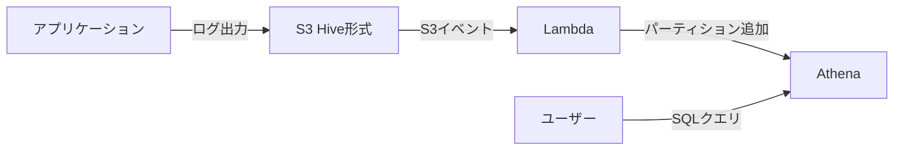

# AWS Athena 導入スクリプト集

このディレクトリには、AWS Athena導入時に必要なスクリプトとSQL定義が含まれています。

## 📁 ファイル一覧

| ファイル名 | 説明 | 言語 |
|-----------|------|------|
| `create_table.sql` | Athenaテーブル作成DDL | SQL |
| `upload_log_hive_format.py` | Hive形式でログをS3にアップロード | Python |
| `partition_auto_add_lambda.py` | パーティション自動追加Lambda関数 | Python |
| `csv_to_parquet.py` | CSV→Parquet変換スクリプト | Python |
| `README.md` | このファイル | Markdown |

---

## 🚀 セットアップ手順

### 1. Athenaテーブル作成

```bash
# create_table.sql をAthenaコンソールで実行
# または、AWS CLIで実行:

aws athena start-query-execution \
  --query-string "$(cat create_table.sql)" \
  --query-execution-context Database=logs_db \
  --result-configuration OutputLocation=s3://athena-results/
```

**重要な編集箇所:**
- `s3://my-logs-bucket/` → 実際のS3バケット名に変更
- 正規表現パターン → 実際のログ形式に合わせて調整

### 2. ログアップロードスクリプト設定

**インストール:**
```bash
pip install boto3
```

**使い方:**
```bash
# 単一ファイルのアップロード
python upload_log_hive_format.py \
  --bucket my-logs-bucket \
  --file /path/to/app.log

# ディレクトリ全体をアップロード
python upload_log_hive_format.py \
  --bucket my-logs-bucket \
  --dir /var/log/app/ \
  --pattern "*.log"

# 過去の日付でアップロード
python upload_log_hive_format.py \
  --bucket my-logs-bucket \
  --file app.log \
  --date 2025-01-15
```

### 3. Lambda関数デプロイ

**手順:**

1. **Lambda関数作成**
   ```bash
   # Lambdaパッケージ作成
   zip partition_lambda.zip partition_auto_add_lambda.py

   # Lambda関数作成
   aws lambda create-function \
     --function-name athena-partition-auto-add \
     --runtime python3.11 \
     --role arn:aws:iam::ACCOUNT_ID:role/LambdaAthenaRole \
     --handler partition_auto_add_lambda.lambda_handler \
     --zip-file fileb://partition_lambda.zip \
     --timeout 60 \
     --memory-size 256 \
     --environment Variables="{
       ATHENA_DATABASE=logs_db,
       ATHENA_TABLE=application_logs,
       ATHENA_OUTPUT_LOCATION=s3://athena-results/
     }"
   ```

2. **IAMロール作成**

   Lambda実行ロールに以下のポリシーをアタッチ:
   - `AmazonS3ReadOnlyAccess`
   - `AmazonAthenaFullAccess`
   - カスタムポリシー（Glue Data Catalog書き込み）:
   ```json
   {
     "Version": "2012-10-17",
     "Statement": [{
       "Effect": "Allow",
       "Action": [
         "glue:GetDatabase",
         "glue:GetTable",
         "glue:GetPartition",
         "glue:GetPartitions",
         "glue:CreatePartition",
         "glue:BatchCreatePartition"
       ],
       "Resource": "*"
     }]
   }
   ```

3. **S3イベントトリガー設定**

   S3コンソールから設定、または:
   ```bash
   aws s3api put-bucket-notification-configuration \
     --bucket my-logs-bucket \
     --notification-configuration file://s3-notification.json
   ```

   `s3-notification.json`:
   ```json
   {
     "LambdaFunctionConfigurations": [{
       "LambdaFunctionArn": "arn:aws:lambda:REGION:ACCOUNT_ID:function:athena-partition-auto-add",
       "Events": ["s3:ObjectCreated:*"],
       "Filter": {
         "Key": {
           "FilterRules": [
             {"Name": "prefix", "Value": "application/"},
             {"Name": "suffix", "Value": ".log"}
           ]
         }
       }
     }]
   }
   ```

### 4. Parquet変換（コスト最適化）

**Athenaで変換（推奨）:**
```bash
python csv_to_parquet.py \
  --method athena \
  --database logs_db \
  --source-table application_logs \
  --dest-table application_logs_parquet \
  --dest-location s3://my-logs-bucket/parquet/ \
  --partition "year='2025' AND month='01' AND day='15'"
```

**ローカルで変換:**
```bash
# PyArrowインストール
pip install pyarrow

# 変換実行
python csv_to_parquet.py \
  --method local \
  --input logs.csv \
  --output logs.parquet \
  --compression SNAPPY
```

---

## 📝 運用フロー

### 日常運用



1. アプリケーションが `upload_log_hive_format.py` または独自実装でHive形式にログ配置
2. Lambda が自動でパーティション追加
3. ユーザーがAthenaでクエリ実行

### 定期メンテナンス

**週次タスク:**
```bash
# パーティション整合性チェック
aws athena start-query-execution \
  --query-string "SHOW PARTITIONS logs_db.application_logs;" \
  --query-execution-context Database=logs_db \
  --result-configuration OutputLocation=s3://athena-results/
```

**月次タスク:**
```bash
# コスト確認
# CloudWatch Metrics: AWS/Athena/DataScannedInBytes を確認

# Parquet変換（月次バッチ）
python csv_to_parquet.py \
  --method athena \
  --database logs_db \
  --source-table application_logs \
  --dest-table application_logs_parquet_202501 \
  --dest-location s3://my-logs-bucket/parquet/202501/ \
  --partition "year='2025' AND month='01'"
```

---

## 🔧 トラブルシューティング

### パーティションが認識されない

**確認:**
```sql
SHOW PARTITIONS logs_db.application_logs;
```

**修正:**
```sql
-- Hive形式の場合、自動修復
MSCK REPAIR TABLE logs_db.application_logs;

-- または手動追加
ALTER TABLE logs_db.application_logs
ADD PARTITION (year='2025', month='01', day='15')
LOCATION 's3://my-logs-bucket/application/year=2025/month=01/day=15/';
```

### Lambda関数が失敗する

**ログ確認:**
```bash
aws logs tail /aws/lambda/athena-partition-auto-add --follow
```

**よくある原因:**
- IAM権限不足
- 環境変数未設定
- S3パスがHive形式でない

### 正規表現がマッチしない

**テスト:**
```sql
SELECT * FROM logs_db.application_logs
WHERE year='2025' AND month='01' AND day='15'
LIMIT 10;
```

すべてNULLの場合、正規表現パターンを修正。

---

## 📚 関連ドキュメント

- [topics/athena/](../../topics/athena/) - 技術リファレンス
- [athena-introduction-3min.md](../athena-introduction-3min.md) - 3分版プレゼン資料
- [athena-introduction-10min.md](../athena-introduction-10min.md) - 10分版プレゼン資料

---

## ⚙️ 環境要件

### Python依存パッケージ

```bash
# 必須
pip install boto3

# Parquet変換（localモード）のみ
pip install pyarrow
```

### AWS権限

**アプリケーション実行ユーザー:**
- `s3:PutObject` （ログアップロード用）

**Lambda実行ロール:**
- `s3:GetObject`, `s3:ListBucket`
- `athena:StartQueryExecution`, `athena:GetQueryExecution`
- `glue:GetDatabase`, `glue:GetTable`, `glue:CreatePartition`

**Athenaクエリ実行ユーザー:**
- `s3:GetObject`, `s3:ListBucket` （データ読み取り）
- `s3:PutObject` （クエリ結果保存）
- `athena:StartQueryExecution`, `athena:GetQueryResults`
- `glue:GetDatabase`, `glue:GetTable`, `glue:GetPartitions`
